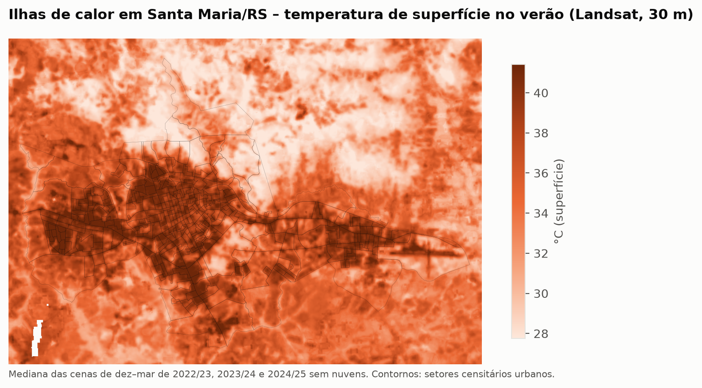
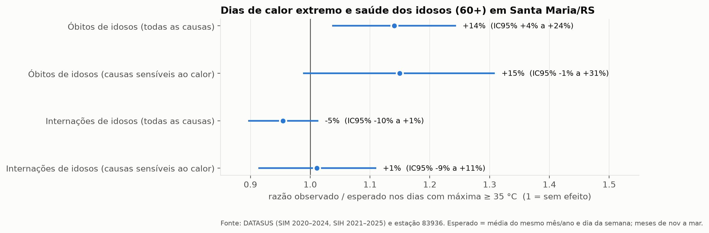
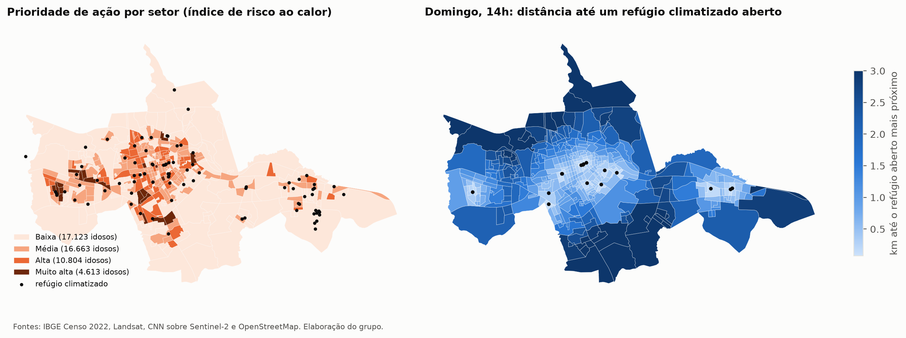

# FIAP - Faculdade de Informática e Administração Paulista

<p align="center">
<a href="https://www.fiap.com.br/">
  
</a>
</p>

<br>

# Refúgio – IA contra o calor extremo para os idosos de Santa Maria/RS

**Global Solution 2026.2 – CitizenTech: tecnologia centrada no cidadão**

## Nome do grupo

> ⚠️ PENDENTE: definir o nome do grupo

## 👨‍🎓 Integrantes:
- Kauan Maciel Forgiarini – RM 574005
- Wagner Adriano de Souza Silva Junior – RM 569431

## 👩‍🏫 Professores:

### Tutor(a)
- > ⚠️ PENDENTE: nome do tutor(a)

### Coordenador(a)
- <a href="https://www.linkedin.com/in/andregodoichiovato/">André Godoi Chiovato</a>

## 📜 Descrição

### O problema

O Rio Grande do Sul é o estado mais envelhecido do Brasil: segundo o Censo 2022, 14,1% da
população tem 65 anos ou mais. Santa Maria, no centro do estado, registrou mais de 40 °C nos
verões de 2020, 2022 e 2025. Ondas de calor atingem principalmente os idosos, porque o corpo
regula pior a temperatura e porque doenças cardiovasculares, respiratórias e renais pioram.
O risco não é igual em toda a cidade: bairros com menos árvores e mais asfalto acumulam mais calor,
formando as **ilhas de calor urbanas** que pesquisadores da UFSM já documentaram em Santa Maria.

### O que os dados reais mostraram

1. **O calor extremo é cada vez mais frequente.** A média de dias por ano com máxima ≥ 35 °C passou
   de 2,8 (1991–2000) para 8,8 (2016–2025). A máxima de verão sobe +0,53 °C por década.
2. **O calor mata idosos em Santa Maria.** Nos dias ≥ 35 °C de 2020–2024, os óbitos de pessoas com
   60 anos ou mais foram **14% maiores que o esperado** (IC95% 4% a 24%; 49 mortes além do esperado).
   O efeito cresce com a temperatura (dose-resposta). As internações não aumentaram: o risco aparece
   antes de a pessoa chegar ao hospital, o que justifica um **alerta preventivo**.
3. **A cidade não esquenta por igual.** No verão, a superfície varia cerca de 9 °C entre bairros
   (32,8 °C no Campestre do Menino Deus e 42,1 °C no Tancredo Neves) e acompanha a falta de vegetação
   (r = −0,78).
4. **15.417 idosos (31%) moram em setores de prioridade alta ou muito alta** de risco ao calor.
5. **O domingo é um "deserto de refúgio".** Num dia útil às 14h, 89% dos idosos têm um local
   climatizado aberto a até 800 m; no domingo, só 45%.

<p align="center"></p>
<p align="center"></p>

### Público beneficiado e atores

- **Os 49.203 idosos** da área urbana de Santa Maria (19,3% da população urbana), principalmente
  nos setores quentes e pouco arborizados.
- **Quem cuida deles:** familiares, cuidadores, agentes comunitários de saúde e ILPIs. São eles que
  recebem os alertas, por texto ou por **ligação de voz** quando a pessoa não lê.
- **Poder público:** a Prefeitura (Saúde, Meio Ambiente e Defesa Civil) recebe o mapa de
  prioridades, onde plantar árvores e onde abrir refúgios nos domingos de calor. A UFSM pode validar
  os resultados em campo.

### Objetivo

Identificar **onde** o calor é mais perigoso para os idosos de Santa Maria e **avisar a tempo** quem
pode protegê-los, recomendando ações concretas: refúgio climático aberto mais próximo, cuidados
oficiais de saúde e plantio de árvores.

### Como funciona

| Módulo | O que faz | Disciplinas | Resultado / situação |
|---|---|---|---|
| Dados e EDA | Integra satélite, Censo, clima (1991–2026) e SUS | Análise exploratória, Python | ✅ 7 fontes públicas reais |
| Calor × saúde | Excesso de óbitos e internações de idosos em dias quentes | Estatística / análise de dados | ✅ +14% de óbitos em dias ≥ 35 °C |
| Mapa de calor | Temperatura de superfície e NDVI do Landsat por setor | Visualização espacial | ✅ 19 cenas de verão, 406 setores |
| Visão computacional | CNN (ResNet-18, *transfer learning*) treinada no EuroSAT e aplicada ao Sentinel-2 de Santa Maria para medir a área construída | Redes neurais / visão computacional | ✅ 98,0% de acurácia no teste (baseline 81,9%); validação externa r = +0,72 com a temperatura |
| Risco e perfis | Índice IPCC (perigo × exposição × vulnerabilidade) + K-Means | Machine Learning | ✅ 3 perfis; 15.417 idosos em prioridade alta |
| Recomendação | Refúgio aberto e adequado para cada pessoa; prioridade de plantio para a Prefeitura | Sistemas de recomendação | ✅ +27% de benefício contra o melhor critério simples |
| Assistente de alertas | O nível é decidido por regra; o Claude (via Amazon Bedrock) redige a mensagem e responde dúvidas usando ferramentas e orientações oficiais (RAG) | IA generativa / agentes | ✅ código e 25 testes. Na demonstração roda em **modo offline** (mensagens de modelo fixo + RAG), porque a conta AWS Academy bloqueia o Bedrock. Em uma conta AWS comum, basta `REFUGIO_LLM_PROVEDOR=bedrock` |
| Sensores | ESP32 + DHT22 no Wokwi com LCD, LEDs, buzzer e botão "pedir ajuda"; MQTT com TLS | IoT / conectividade | ✅ firmware compila; ponte testada; ⏳ teste em tempo real no Wokwi |
| Banco de dados | 13 tabelas (SQLite + script Oracle), visão e 7 consultas de negócio; NoSQL (DynamoDB) para leituras | Banco de dados | ✅ |
| Nuvem | DynamoDB (leituras dos sensores), SNS (envio dos alertas), Bedrock | Computação em nuvem | ✅ testado na AWS em 08/11/2026: 6 leituras gravadas no DynamoDB e alerta publicado no SNS. ⚠️ A conta AWS Academy bloqueia o Bedrock (AccessDenied em todos os modelos), então o assistente usa a mensagem de modelo fixo |
| Segurança | LGPD (saúde só agregada, cadastro simulado), TLS + HMAC + anti-replay no MQTT, defesas do OWASP Top 10 para LLM | Cibersegurança | ✅ 17 testes de segurança (adulteração, replay, injeção, dados pessoais) |
| Painel | Streamlit com 5 indicadores e 6 abas: mapa de risco interativo, recomendação de refúgio, simulação de alertas, chat do assistente, sensores e dados/modelos | Aplicações interativas | ✅ `streamlit run src/app/painel.py`; 2 testes automatizados |

Arquitetura e modelo de dados: [docs/arquitetura.md](docs/arquitetura.md).

<p align="center"></p>

### Objetivos de Desenvolvimento Sustentável (ODS) e como medir o impacto

| ODS | Contribuição | Indicador de impacto |
|---|---|---|
| **3 – Saúde e Bem-Estar** | Alerta preventivo a quem cuida do idoso | Excesso de óbitos de idosos em dias ≥ 35 °C (linha de base: +14%), medido com o mesmo método nos verões seguintes |
| **11 – Cidades Sustentáveis** | Prioridade de plantio e de refúgios | % de idosos com refúgio climatizado aberto a até 800 m no domingo (linha de base: 45%); NDVI dos setores prioritários |
| **13 – Ação Climática** | Adaptação a eventos de calor extremo | Alertas entregues por onda de calor; tempo entre a previsão e o aviso |

## 📁 Estrutura de pastas

* **`data/`** – `raw/` (baixado pelos scripts, fora do Git) e `processed/` (bases tratadas e o banco
  `refugio.db`). Fontes, tratamentos e limitações: [data/README.md](data/README.md).
* **`docs/`** – arquitetura, figuras (`img/`), relatório (`relatorio/Refugio_GS2026-2.pdf`, gerado de `relatorio/relatorio.html`) e roteiro do vídeo (`roteiro_video.md`).
* **`notebooks/`** – `01_analise_exploratoria.ipynb` e `02_modelos_ia.ipynb`, executados e com saídas.
* **`src/`** – código-fonte:
  * `config.py` – parâmetros da cidade e dos limiares de calor;
  * `data/` – download e tratamento das bases (inclui um leitor de `.dbc` do DATASUS em Python puro);
  * `analise/` – calor × saúde e figuras;
  * `ml/` – CNN de uso do solo, índice de risco/K-Means e recomendadores (modelo salvo em `ml/modelos/`);
  * `db/` – esquema SQLite e Oracle, carga e consultas;
  * `iot/` – firmware do ESP32 para o Wokwi, protocolo seguro e ponte MQTT ([src/iot/README.md](src/iot/README.md));
  * `agente/` – assistente de alertas com IA generativa ([src/agente/README.md](src/agente/README.md));
  * `cloud/` – criação dos recursos na AWS.
* **`tests/`** – 43 testes automatizados (`python -m pytest`).

## 📎 Links e Observações

### 🔗 Links do Projeto

* **Vídeo de demonstração (YouTube, não listado):** > ⚠️ PENDENTE
* **Repositório GitHub (privado, compartilhado com `fiap-tutoria`):** > ⚠️ PENDENTE

### 🧠 Decisões Técnicas

> - **Santa Maria/RS:** é a cidade do grupo, tem calor extremo documentado, está no estado mais
>   envelhecido do país e tem estudos da UFSM sobre ilhas de calor para validar os resultados.
> - **Somente dados públicos e reais** nas análises. Os dados simulados (sensores no Wokwi e o
>   cadastro de idosos) são identificados como tal no banco e na interface.
> - **CNN por transfer learning:** a ResNet-18 pré-treinada superou uma CNN treinada do zero (98,0%
>   contra 95,4%) em metade do tempo e foi escolhida pela validação, não pelo teste.
> - **Validação externa da CNN:** sem rótulos locais, comparamos a área construída estimada com o
>   NDVI e a temperatura do Landsat, que a CNN nunca viu.
> - **O nível do alerta é uma regra, não a IA:** a decisão fica auditável e o alerta sai mesmo sem IA.
>   O Claude só redige a mensagem, e a saída é validada (192, refúgio, sem dados pessoais).
> - **Leitor de `.dbc` próprio:** portamos o descompressor `blast.c` (zlib) para Python, para o
>   projeto rodar sem compilador C.
> - **Privacidade (LGPD):** dados individuais de saúde nunca saem de `data/raw/`. A IA recebe só o
>   primeiro nome, a idade e o bairro.

### 📢 Observações Gerais

* **Participação na Competição:** [x] Sim, aceitamos participar / [ ] Não vamos participar.

## 🔧 Como executar o código

Pré-requisitos: Python 3.12 ou superior (testado no 3.14), cerca de 1 GB livre e internet.

```bash
cd 1TIAO/GLOBAL-SOLUTION-2
python -m venv .venv
.venv\Scripts\activate            # Windows  (Linux/Mac: source .venv/bin/activate)
pip install torch torchvision --index-url https://download.pytorch.org/whl/cpu
pip install -r requirements.txt
copy .env.example .env            # Linux/Mac: cp .env.example .env

# 1. Dados (~650 MB) e tratamento
python -m src.data.baixar_dados
python -m src.data.processar_landsat
python -m src.data.processar_censo
python -m src.data.processar_clima
python -m src.data.processar_saude

# 2. Análises e modelos
python -m src.analise.calor_saude
python -m src.ml.cnn_eurosat          # ~45 min em CPU (o modelo treinado já está em src/ml/modelos/)
python -m src.ml.aplicar_cnn
python -m src.data.processar_osm
python -m src.ml.vulnerabilidade
python -m src.ml.recomendacao
python -m src.db.banco
python -m src.analise.figuras

# 3. Sensores, alertas e testes
python -m src.iot.ponte_mqtt --simular 20 --duracao 15
python -m src.agente.alerta 12 --tmax 36.5       # sem credenciais de IA, usa a mensagem de modelo fixo
python -m pytest

# 4. Painel
streamlit run src/app/painel.py                  # abre em http://localhost:8501
```

---

## 📋 Licença

<p xmlns:cc="http://creativecommons.org/ns#" xmlns:dct="http://purl.org/dc/terms/"><a property="dct:title" rel="cc:attributionURL" href="https://github.com/fiap-tutoria/FIAP-PORTFOLIO-AI">TEMPLATE - FIAP PORTFÓLIO AI</a> por <a rel="cc:attributionURL dct:creator" property="cc:attributionName" href="https://fiap.com.br">FIAP</a> está licenciado sobre <a href="http://creativecommons.org/licenses/by/4.0/?ref=chooser-v1" target="_blank" rel="license noopener noreferrer" style="display:inline-block;">Attribution 4.0 International</a>.</p>
