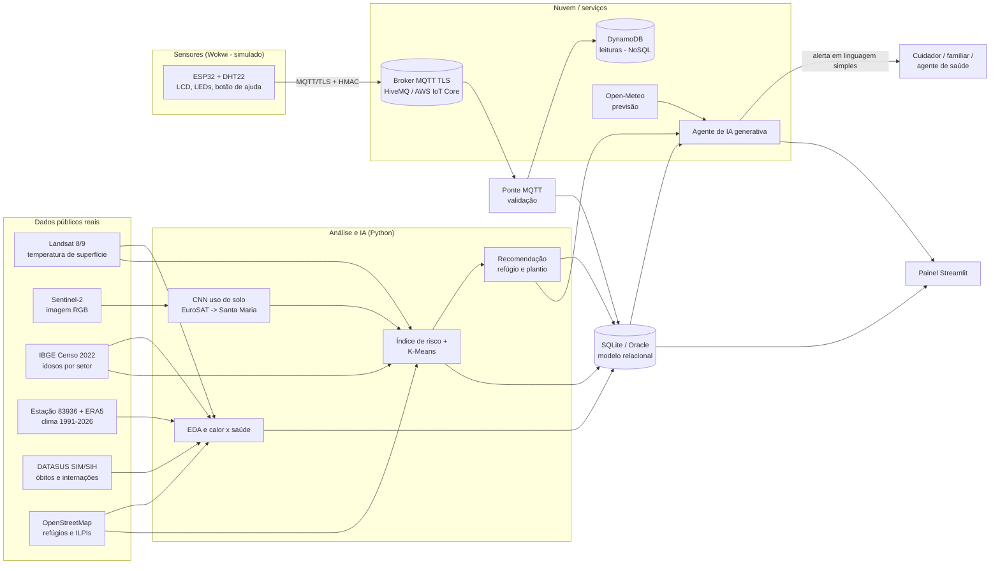
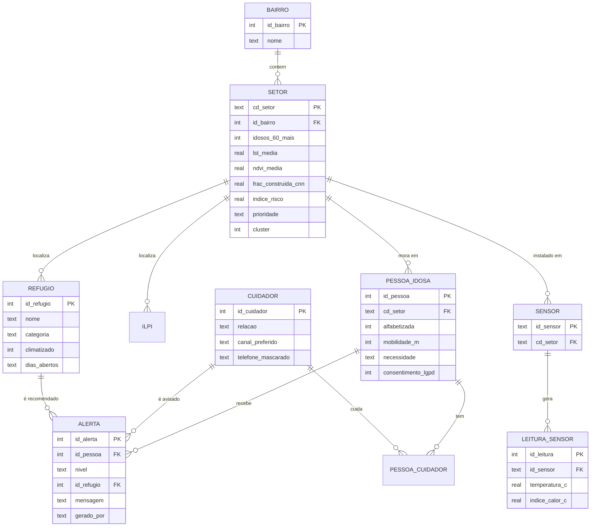

# Arquitetura do Refúgio

## Visão geral

## Modelo de dados (DER)

Tabelas independentes: `CLIMA_DIARIO` (série diária) e `SAUDE_DIARIA` (contagens agregadas de
óbitos e internações, sem dados individuais).

## Decisões de projeto

| Decisão | Motivo |
|---|---|
| **SQLite** local + **script Oracle** equivalente | Roda em qualquer máquina sem servidor. O script Oracle (`src/db/schema_oracle.sql`) mostra a modelagem no SGBD usado nas aulas |
| **NoSQL (DynamoDB)** para leituras de sensores | Série temporal de alto volume, chave natural `id_sensor` + `seq` e sem joins |
| **Relacional** para o domínio (setores, pessoas, alertas) | Integridade referencial, restrições (`CHECK`) e consultas analíticas com joins |
| Cálculo de risco no **dispositivo** (edge) | O LED e o buzzer avisam quem está perto mesmo sem internet |
| **HMAC + TLS** no MQTT | O broker de demonstração é público: garante autenticidade, integridade e confidencialidade |
| Dados de saúde **só agregados** | LGPD: dados de saúde são sensíveis (art. 11). Nada individual sai de `data/raw/` |
| Cadastro de idosos **simulado** | Não coletamos dados pessoais reais. O cadastro fictício segue a distribuição real do Censo |
